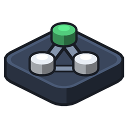
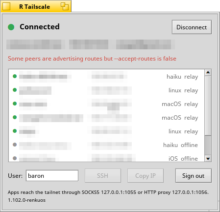

# Tailscale per RenkuOS

[English](README.md) · Italiano · [日本語](README.ja.md) · [한국어](README.ko.md)

Un port non ufficiale di Tailscale per RenkuOS (Haiku): il demone
`tailscaled`, la CLI `tailscale` e **R Tailscale**, una finestra nativa per
usarli. Non affiliato a Tailscale Inc.



## Installazione con pkgman

| Sistema | Comandi |
| --- | --- |
| arm64 | `pkgman add-repo http://pkgman.rainygirl.com/arm64`<br>`pkgman install renkuos_rtailscale` |
| x86_64 | `pkgman add-repo https://pkgman.rainygirl.com/x86_64`<br>`pkgman install renkuos_rtailscale` |
| x86 a 32 bit (x86_gcc2) | `pkgman add-repo https://pkgman.rainygirl.com/x86_gcc2`<br>`pkgman install renkuos_rtailscale_x86` |

Se `pkgman add-repo` fallisce con `Operation not supported`, il network kit di
quell'immagine non ha TLS: nell'indirizzo usa `http://` al posto di `https://`.

Il pacchetto installa `tailscale`, `tailscaled`, R Tailscale (in Deskbar ->
Applications) e un job di launch che avvia il servizio all'accesso. Subito
dopo l'installazione, prima dell'accesso successivo, è R Tailscale ad avviare
il servizio.

## Accesso

Apri **R Tailscale** da Deskbar -> Applications e premi **Sign in**. Mostra il
link di accesso e lo apre nel browser; il link si può aprire anche da un altro
dispositivo.

## Installazione da un checkout

Senza pacchetto, da un checkout in cui `dist/<arch>/` è già compilato:

```sh
./install.sh                 # in ~/config/non-packaged; --uninstall lo rimuove
```

## Disinstallazione

```sh
pkgman uninstall renkuos_rtailscale
```

Su x86 a 32 bit il pacchetto da rimuovere è `renkuos_rtailscale_x86`.

## x86 a 32 bit

Il pacchetto a 32 bit è `renkuos_rtailscale_x86`. Il demone e la CLI vengono da
un port separato e molto più grande, con il suo launcher (`tailscale-haiku`),
le sue istruzioni di compilazione e le sue note: vedi [`i386/`](i386/).

## Uso dell'IA

Parti di R Tailscale sono state sviluppate con l'aiuto di strumenti di programmazione basati sull'IA (Claude di Anthropic). Tutto il codice è stato rivisto e testato dall'autore.
